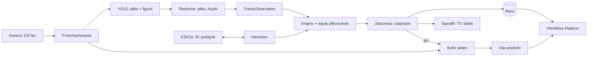

# PitchWise.Foosball — architektura i plan budowy

System statystyk dla piłkarzyków 1v1 w barze. Kamera nad stołem i YOLO śledzą piłkę i figurki,
czujniki IR liczą gole, a podajnik sam wprowadza piłkę. Goście widzą wynik i statystyki na żywo
na telewizorze, a bar może robić rankingi (np. najszybszy strzał wieczoru).

## Założenia

- Mecze 1v1, jeden stół (mniejszy), jaskrawa **matowa żółta piłka** dobrana pod kamerę.
- Bar to nie laboratorium: własne oświetlenie LED stołu, elektronika schowana, start jednym przyciskiem.
- Obsługuje to barman, więc system kalibruje się raz i potem działa bez ingerencji.
- **Gol liczy czujnik IR** (źródło prawdy). Kamera tylko go potwierdza i dostarcza resztę statystyk.
- Opóźnienie ekranu do ~1 s jest akceptowalne (to wyświetlanie, nie sterowanie).
- Poza zakresem na teraz: kamery boczne i w bramkach. Architektura je przewiduje (bufor wideo, zdarzenie „gol” jako wyzwalacz).

## Sprzęt

| Element | Rola |
|---|---|
| Kamera z migawką globalną, 120+ fps, USB3 | Obraz z góry stołu |
| Stelaż + oświetlenie LED | Stała geometria i światło niezależne od baru |
| Mini PC z kartą NVIDIA (albo Jetson Orin) | YOLO na żywo, cały system |
| ESP32 + 2 bariery IR | Wykrywanie goli |
| Podajnik (silnik/serwo) | Wprowadzanie piłki po golu |
| Telewizor + tablet | Tablica wyników, logowanie graczy |

## Przepływ danych

Kontrakt między wizją a logiką gry to `FrameObservation` z `PitchWise.Engine`:
pozycja piłki i „zawodników” w metrach. **Engine nigdy nie widzi pikseli.**
Drążki trafiają do Engine jako wirtualni zawodnicy (stała współrzędna drążka, druga współrzędna
z obrazu), dzięki czemu `PossessionTracker` działa bez zmian.

## Projekty

| Projekt | Zależy od | Odpowiedzialność |
|---|---|---|
| `PitchWise.Engine` | — | **Bez zmian.** Filtr piłki, posiadanie, silnik reguł |
| `PitchWise.Foosball` | Engine | Model stołu (wymiary, drążki), konfiguracja, `EngineConfig` dla piłkarzyków, reguły: gol, strzał, prędkość, podanie między drążkami |
| `PitchWise.Foosball.Vision` | Foosball, OpenCvSharp4, OnnxRuntime | Źródła klatek (plik, kamera), detektor YOLO, kalibracja stołu, śledzenie piłki i drążków, budowa `FrameObservation` |
| `PitchWise.Foosball.Hardware` | Foosball | Protokół szeregowy z ESP32: gole IR, podajnik, przyciski |
| `PitchWise.Foosball.Host` | wszystkie powyższe | Usługa w barze: pipeline na żywo, SignalR dla TV i tabletu, bufor wideo i klipy |
| `PitchWise.Cli` | + Foosball.Vision | Komenda `foosball` do analizy nagrań offline, ten sam format wyjścia co `analyze` |
| `firmware/` | — | Kod ESP32 |
| `tools/training/` | — | Dataset i trening YOLO (Python), eksport do ONNX |
| `tests/PitchWise.Foosball.Tests` | — | Testy jednostkowe i testy na oznaczonych klatkach |

Zasady:
- `PitchWise.Engine` i `PitchWise.GameState` nie są modyfikowane. Foosball dodaje rzeczy obok.
- Biblioteki Foosball nie zależą od `PitchWise.GameState` ani `PitchWise.App.Core`.
- Wyjście offline jest zgodne z komendą `analyze`: `result.json`, `world_state.jsonl`, wideo z nakładką.
  Dzięki temu działa `WorldStateReplay` i aplikacja desktopowa.

## Statystyki

Gole, strzały i celność, prędkość strzału (maks. i średnia), posiadanie per drążek i gracz,
podania między drążkami, mapa cieplna piłki, czas meczu. Później: wykrywanie niedozwolonego kręcenia (z obrotu drążków).

---

## Plan budowy

Każdy krok ma **cel** (po co), **zakres** (co dokładnie) i **gotowe, gdy** (jak sprawdzić).
Jeden krok = jeden mały commit. Kroki odhaczamy tutaj.

### Etap 1 — Szkielet i dane

- [ ] **1.1 Szkielet projektów**
  - Cel: mieć miejsce na kod, zanim powstanie kod.
  - Zakres: puste projekty `PitchWise.Foosball`, `PitchWise.Foosball.Vision`, `tests/PitchWise.Foosball.Tests`, dodane do `PitchWise.slnx`.
  - Gotowe, gdy: `dotnet build` i `dotnet test` przechodzą, jeden test-placeholder jest zielony.
- [ ] **1.2 Model stołu**
  - Cel: jedno miejsce prawdy o geometrii stołu (jak `PitchModel` dla boiska).
  - Zakres: wymiary boiska, położenia 8 drążków, przypisanie drążków do graczy, wymiary bramek. Wartości z konfiguracji.
  - Gotowe, gdy: testy sprawdzają, że drążki leżą na boisku i są symetryczne między stronami.
- [ ] **1.3 Nagrania testowe**
  - Cel: materiał do pracy niezależny od baru.
  - Zakres: 10–20 min gry z góry (najlepiej docelową kamerą, ewentualnie telefon w slow-mo), w tym mocne strzały, zasłonięcia, gole.
  - Gotowe, gdy: pliki opisane w `docs/foosball/recordings.md` (co jest na którym, fps, rozdzielczość). Wideo poza repo.
- [ ] **1.4 Wycinanie klatek do oznaczania**
  - Cel: dane do treningu YOLO.
  - Zakres: skrypt w `tools/training/` wybierający różnorodne klatki (co N-ta + klatki z szybkim ruchem).
  - Gotowe, gdy: ~500–1000 klatek w katalogu, gotowych do importu w CVAT albo Roboflow.
- [ ] **1.5 Oznaczenie danych**
  - Cel: zbiór uczący.
  - Zakres: klasy `ball` i `figure`. Podział train/val/test.
  - Gotowe, gdy: eksport w formacie YOLO i krótki opis klas i zasad oznaczania w `tools/training/README.md`.

### Etap 2 — YOLO

- [ ] **2.1 Pierwszy trening**
  - Cel: działający model, nawet słaby.
  - Zakres: mały model (np. YOLO11n), domyślne ustawienia, trening w Colab albo lokalnie.
  - Gotowe, gdy: zapisane mAP dla `ball` i `figure` na zbiorze val.
- [ ] **2.2 Eksport do ONNX**
  - Cel: model gotowy do .NET.
  - Zakres: eksport, opis w `docs/MODELS.md`, plik modelu poza repo (jak reszta modeli).
  - Gotowe, gdy: model ładuje się w ONNX Runtime i zwraca wyjście o oczekiwanym kształcie.
- [ ] **2.3 Ocena na trudnych przypadkach**
  - Cel: wiedzieć, gdzie model zawodzi, zanim zbudujemy na nim resztę.
  - Zakres: recall piłki osobno dla: piłka swobodna, szybki strzał, częściowe zasłonięcie.
  - Gotowe, gdy: tabela wyników w `docs/foosball/eval.md` i decyzja: wystarczy / dooznaczyć dane.

### Etap 3 — Vision na nagraniach

- [ ] **3.1 Źródło klatek z pliku**
  - Cel: jednolity sposób podawania klatek (później podmienimy na kamerę).
  - Zakres: interfejs źródła klatek + implementacja dla pliku wideo, z numerem klatki i znacznikiem czasu.
  - Gotowe, gdy: test czyta krótkie wideo i zgadza się liczba klatek oraz fps.
- [ ] **3.2 Detektor YOLO**
  - Cel: piłka i figurki na pojedynczej klatce, w pikselach.
  - Zakres: interfejs detektora + implementacja ONNX (preprocessing, NMS). Bez śledzenia.
  - Gotowe, gdy: test na kilku oznaczonych klatkach znajduje piłkę w zadanej tolerancji.
- [ ] **3.3 Komenda CLI z nakładką**
  - Cel: zobaczyć detekcję na całym nagraniu.
  - Zakres: `foosball detect wejście.mp4 wyjście.mp4` rysuje boksy i wypisuje % klatek z piłką.
  - Gotowe, gdy: wideo z boksami i liczba na wyjściu.
- [ ] **3.4 Kalibracja stołu**
  - Cel: przejście z pikseli na metry.
  - Zakres: 4 narożniki boiska → homografia, zapis do pliku kalibracji. Narożniki podawane ręcznie (z pliku/argumentu).
  - Gotowe, gdy: test: narożniki obrazu mapują się na narożniki modelu stołu z błędem < 2 mm.
- [ ] **3.5 Korekcja dystorsji**
  - Cel: proste linie stołu na obrazie z szerokiego obiektywu.
  - Zakres: kalibracja szachownicą (jednorazowa), parametry w pliku, zastosowanie przed homografią.
  - Gotowe, gdy: błąd reprojekcji zapisany, linie boiska proste na podglądzie.
- [ ] **3.6 Śledzenie piłki**
  - Cel: gładka trajektoria, która przeżywa krótkie zasłonięcia.
  - Zakres: detekcja → `BallObservation` → `BallFilter` z `EngineConfig` dla piłkarzyków.
  - Gotowe, gdy: na nakładce widać trajektorię, a w krótkich zasłonięciach pozycja jest przewidywana.
- [ ] **3.7 Pozycje drążków**
  - Cel: wiedzieć, gdzie są figurki każdego drążka.
  - Zakres: figurki z detektora przypisane do drążków po współrzędnej wzdłuż stołu, przesunięcie drążka z ich położenia.
  - Gotowe, gdy: na nakładce każdy drążek ma swoją pozycję i nie skacze między klatkami.
- [ ] **3.8 Budowa `FrameObservation`**
  - Cel: zamknąć kontrakt wizja → Engine.
  - Zakres: piłka + drążki jako wirtualni zawodnicy. Zapis `world_state.jsonl` jak w `analyze`.
  - Gotowe, gdy: plik odtwarza się przez `WorldStateReplay`.

### Etap 4 — Reguły i statystyki

- [ ] **4.1 Posiadanie per drążek i gracz**
  - Cel: pierwsza statystyka z Engine.
  - Zakres: `PossessionTracker` na wirtualnych zawodnikach, dostrojone parametry.
  - Gotowe, gdy: suma posiadania obu graczy ≈ czas z widoczną piłką, wynik w `result.json`.
- [ ] **4.2 Prędkość piłki**
  - Cel: dane do „najszybszego strzału”.
  - Zakres: prędkość z filtra, wygładzona, w km/h.
  - Gotowe, gdy: na nakładce prędkość, wartości zgodne z ręcznym pomiarem na kilku strzałach.
- [ ] **4.3 Reguła: strzał**
  - Cel: zdarzenie strzału z prędkością i autorem.
  - Zakres: nagły wzrost prędkości po kontakcie z drążkiem gracza, kierunek ku bramce rywala.
  - Gotowe, gdy: na oznaczonym fragmencie wykryte strzały zgadzają się z ręcznie policzonymi.
- [ ] **4.4 Reguła: gol z obrazu**
  - Cel: gol bez czujników (na nagraniach) i późniejsze potwierdzenie IR.
  - Zakres: piłka znika w strefie bramki po strzale.
  - Gotowe, gdy: wszystkie gole z nagrań wykryte, zero fałszywych.
- [ ] **4.5 Reguła: podanie między drążkami**
  - Cel: dodatkowa statystyka.
  - Zakres: zmiana posiadania między drążkami tego samego gracza.
  - Gotowe, gdy: zdarzenia widoczne w `result.json` i zgodne z nagraniem.
- [ ] **4.6 Mapa cieplna i podsumowanie meczu**
  - Cel: pełny `result.json` dla meczu.
  - Zakres: mapa cieplna piłki, statystyki per gracz.
  - Gotowe, gdy: komenda `foosball analyze` daje komplet plików jak `analyze`.

### Etap 5 — Sprzęt

- [ ] **5.1 Protokół ESP32 ↔ PC**
  - Cel: ustalony format wiadomości, zanim powstanie kod po obu stronach.
  - Zakres: opis w `docs/foosball/protocol.md` (gol, przycisk, polecenia podajnika, heartbeat).
  - Gotowe, gdy: dokument zaakceptowany.
- [ ] **5.2 Firmware: bariery IR**
  - Cel: pewne wykrywanie gola.
  - Zakres: odczyt barier, eliminacja drgań, wysyłanie zdarzeń.
  - Gotowe, gdy: 50 wrzuconych piłek = 50 zdarzeń.
- [ ] **5.3 `Foosball.Hardware`: odczyt zdarzeń**
  - Cel: gole z IR w .NET.
  - Zakres: połączenie szeregowe, parser, ponowne łączenie po odłączeniu.
  - Gotowe, gdy: test z symulowanym portem + test na prawdziwym ESP32.
- [ ] **5.4 Firmware + sterowanie podajnikiem**
  - Cel: wprowadzanie piłki po golu.
  - Zakres: polecenie „podaj”, potwierdzenie wykonania, zabezpieczenie przed zacięciem.
  - Gotowe, gdy: 20 podań bez zacięcia.

### Etap 6 — Na żywo w barze

- [ ] **6.1 Źródło klatek z kamery**
  - Cel: ten sam pipeline na żywo.
  - Zakres: implementacja źródła klatek dla kamery, pomiar rzeczywistego fps.
  - Gotowe, gdy: stabilne 120 fps przez 10 minut.
- [ ] **6.2 Host: pipeline na żywo**
  - Cel: działający system bez UI.
  - Zakres: usługa łącząca kamerę, detekcję, Engine i sprzęt. Gol z IR scalany z obrazem.
  - Gotowe, gdy: mecz na żywo daje poprawny `result.json`, opóźnienie zmierzone.
- [ ] **6.3 Tablica wyników na TV**
  - Cel: wrażenia dla gości.
  - Zakres: SignalR + prosta strona: wynik, ostatni strzał (km/h), ranking wieczoru.
  - Gotowe, gdy: wynik na ekranie zmienia się < 1 s po golu.
- [ ] **6.4 Logowanie graczy na tablecie**
  - Cel: statystyki przypisane do osób.
  - Zakres: wybór/QR gracza przed meczem, strony stołu.
  - Gotowe, gdy: statystyki meczu zapisane z nickami.
- [ ] **6.5 Bufor wideo i klip po golu**
  - Cel: podstawa pod powtórki.
  - Zakres: bufor ostatnich ~5 s, zapis klipu na zdarzenie „gol”.
  - Gotowe, gdy: każdy gol ma swój klip.

### Etap 7 — Integracja z PitchWise.Platform

- [ ] **7.1** Wysyłanie wyników meczów i klipów do Platform.
- [ ] **7.2** Gracze, turnieje i rankingi po stronie Platform.
